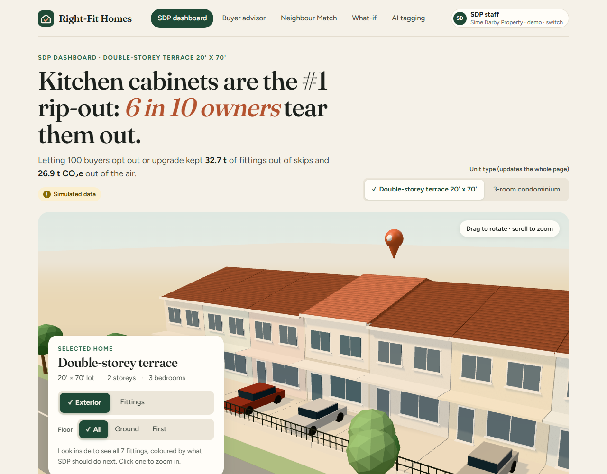
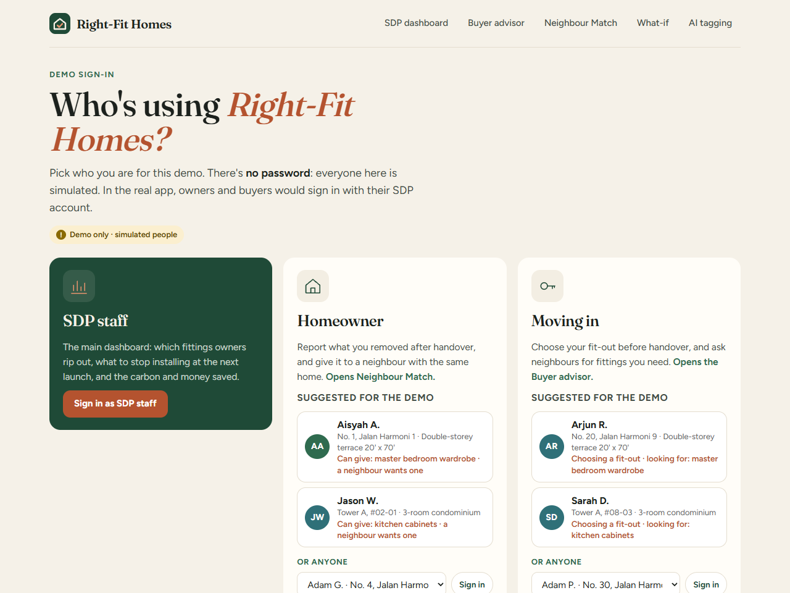
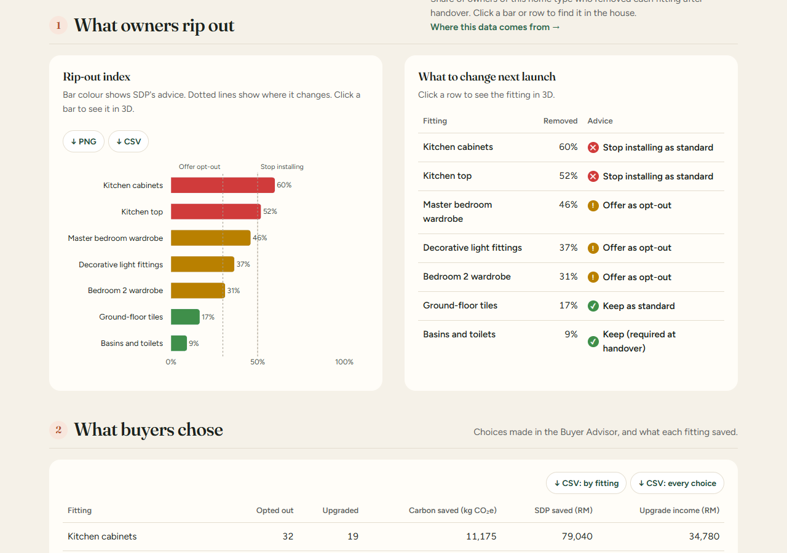
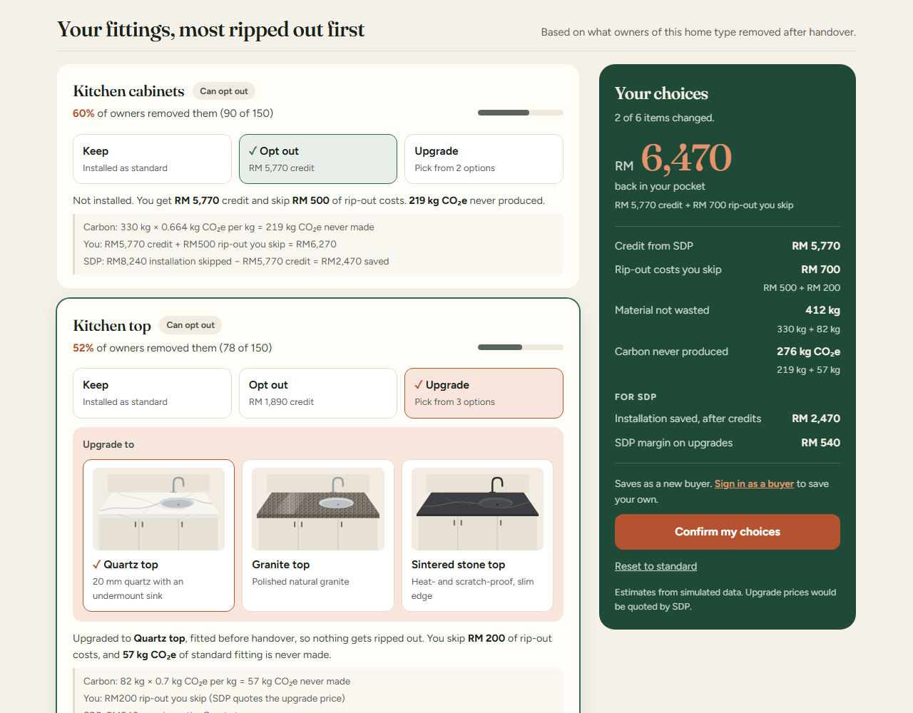
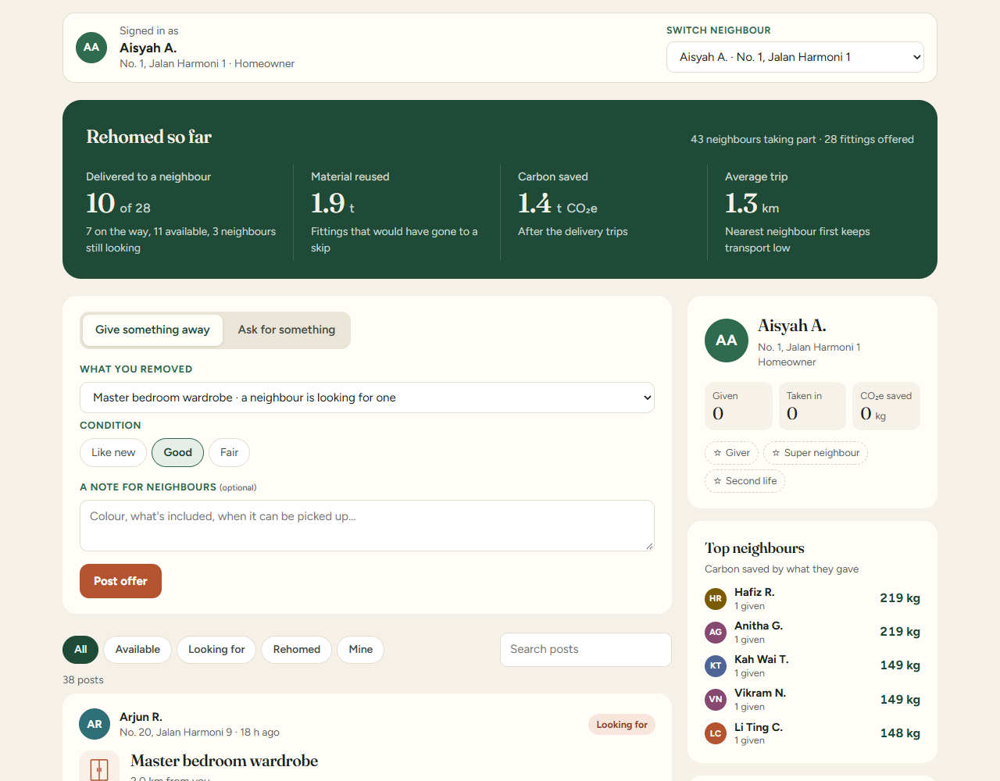
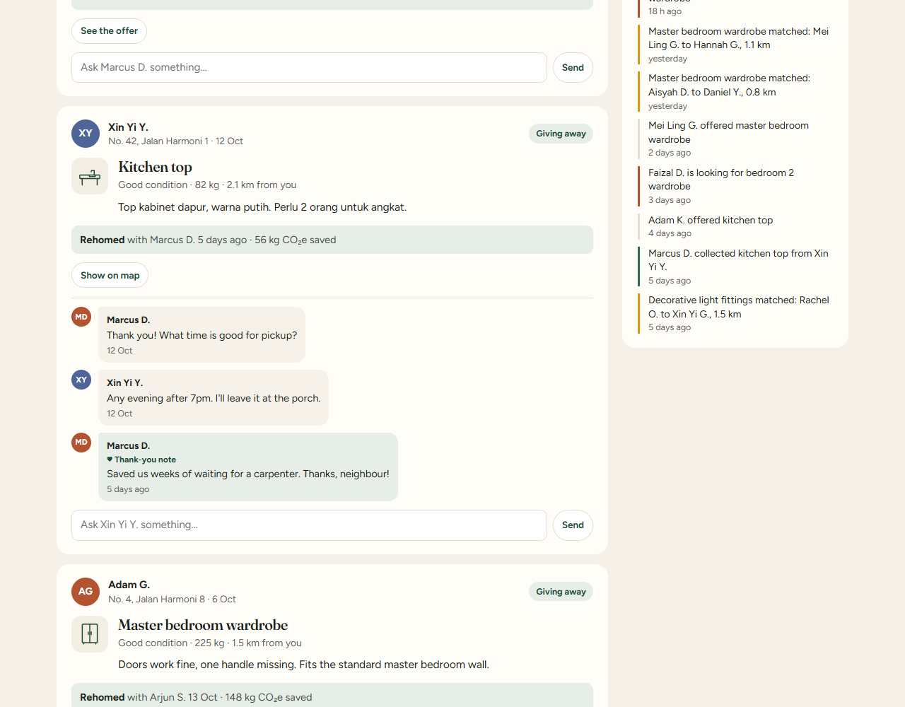
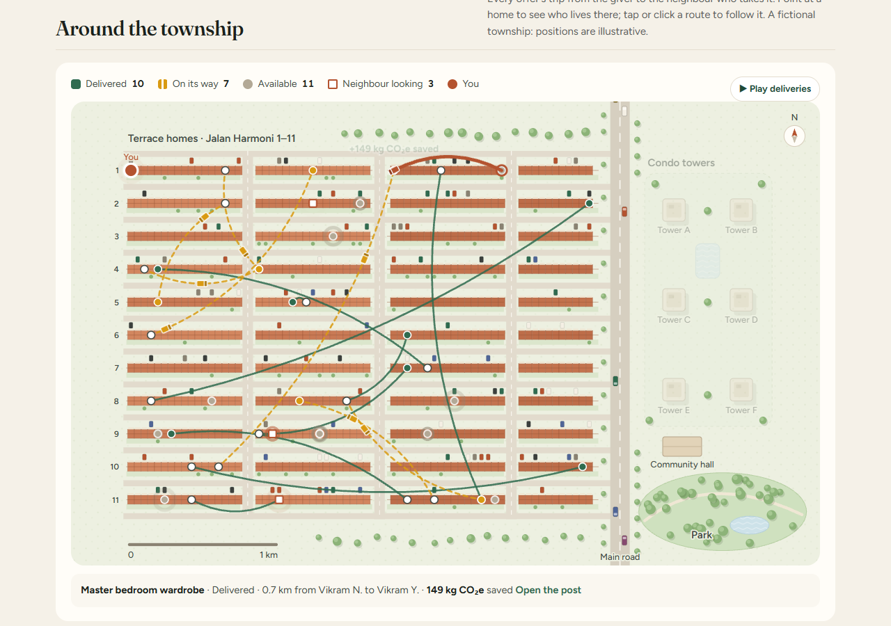
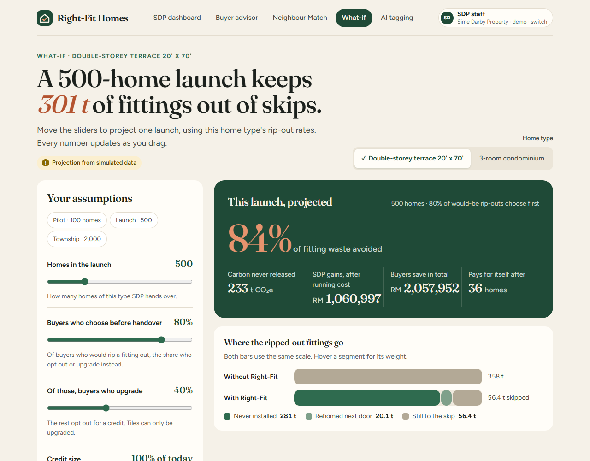
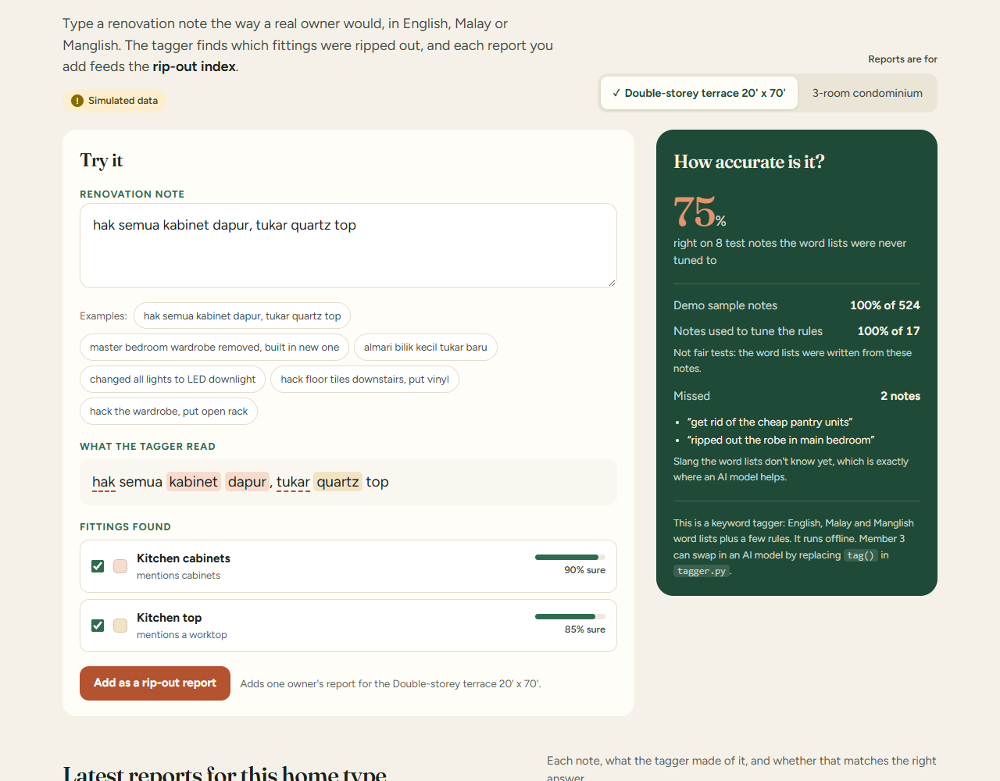

# Right-Fit Homes

**Stop building what buyers tear out.** Many new home owners rip out
brand-new kitchens, wardrobes and tiles soon after handover. Right-Fit Homes
lets buyers keep, opt out of, or upgrade each fitting *before* it is built,
and shows Sime Darby Property (SDP) the waste, carbon and money saved.
A demo for the Sime Darby Property hackathon (Planet track: circular economy
and waste).



| Page | What it does |
| --- | --- |
| Demo sign-in | Pick who you are: SDP staff, a homeowner or a buyer moving in. No password (simulated people) |
| SDP dashboard | The main page. Rip-out index, "stop installing" advice for the next launch, carbon and RM saved, which upgrades buyers pick |
| Buyer advisor | Keep, opt out for a credit, or pick an upgrade option, with live savings and a 3D model of the home that shows the chosen finish |
| Neighbour Match | A community board for each home type: neighbours give away fittings they removed, ask for ones they need, chat, and say thanks. The nearest same-design home gets it |
| What-if | Projects a whole launch: waste avoided, carbon, SDP's gain and payback |
| AI tagging | Sorts messy renovation notes (English and Malay) into fittings, with an honest accuracy score |

Built with Flask, pandas, Plotly and three.js, and runs offline.

**All data is simulated.** The homes, owners, rip-out rates, buyer choices,
Neighbour Match posts and messages, and the neighbours' names and addresses are
made up. The fittings' weights, carbon factors and
prices are realistic estimates from public sources: see
[Where the numbers come from](#where-the-numbers-come-from). There is no survey
data.

## A quick tour

Screenshots of each page with the demo data, taken at 1280 px wide. See
[Run it](#run-it) to open the app yourself.

**1. Demo sign-in** (`/`, then `/signin`). Pick SDP staff, a homeowner or a buyer
moving in. No password: everyone is simulated. A suggested person per home type
makes the demo quick.



**2. SDP dashboard** (`/dashboard`), the main page. The top (shown above) names
the fitting most owners rip out and shows the home in 3D. Further down, the
rip-out index says what to stop installing at the next launch: red is stop
installing, amber is offer as an opt-out, green is keep.



**3. Buyer advisor** (`/advisor`). Here a buyer opts out of the kitchen cabinets
and upgrades the kitchen top to quartz. Each choice shows the sum behind its
numbers (carbon, what the buyer saves, what SDP saves), and the box on the right
adds them up.



**4. Neighbour Match** (`/match`), signed in as homeowner Aisyah A. Give away a
fitting you removed or ask for one; the sidebar shows your profile, badges and
the top neighbours.



The feed: each post shows who, where, how far from you, its status and the
chat. Here the kitchen top was rehomed, and the neighbour left a thank-you note.



The township map: every terrace house, the streets, condo towers, park and
traffic. Delivered routes draw themselves in, vans drive the fittings that are
on their way, and pointing at a home shows who lives there. Click a route (or
Play deliveries) to follow a van and see the carbon it saved. The condo view
zooms in on the towers. Nothing moves for viewers who ask for reduced motion.



**5. What-if** (`/simulate`). Move the sliders to project a whole launch: waste
avoided, carbon, SDP's gain after its running cost, and when it pays for itself.



**6. AI tagging** (`/tagger`). A messy note in Malay and English is sorted into
fittings, with how sure the tagger is, and can be saved as a rip-out report.
Claude reads the note when an API key is set; offline keyword rules read it
otherwise, and take over whenever Claude can't answer.



## Run it

```bash
pip install flask pandas plotly
python app.py                     # open http://127.0.0.1:5000 (builds the database on the first run)
python test_impact.py             # checks the maths, the database and every page
python generate_dummy_data.py     # rebuilds the demo database from scratch, any time
```

AI tagging uses Claude when it can, and the offline keyword rules otherwise.
To turn Claude on (optional; everything else works without it):

```bash
pip install anthropic
export ANTHROPIC_API_KEY=sk-ant-...   # Windows PowerShell: $env:ANTHROPIC_API_KEY = "sk-ant-..."
python app.py                         # the AI tagging page now says "Read by Claude"
python tagger.py --ai                 # Claude's accuracy on the 25 test notes (25 API calls)
```

`TAGGER_MODEL` picks the model (default `claude-opus-5-5`; `claude-haiku-5-5`
is cheaper and faster). Only the note typed on the AI tagging page goes to
Claude, and each different note is asked once. If Claude can't be reached, is
too slow (15 s), declines, or sends an answer that can't be read, the keyword
rules tag the note and the page says why. The tests never call Claude: they
use a stand-in.

Debug mode (error pages with the code, auto-reload) is off unless you ask for
it: `FLASK_DEBUG=1 python app.py`. Never turn it on when other people can reach
the app, for example with `flask run --host 0.0.0.0` to show it on phones.

- `/` opens the demo sign-in (`/signin`) the first time, then the SDP dashboard
- `/signin`: demo sign-in. SDP staff go to the dashboard, homeowners to Neighbour Match, buyers moving in to the Advisor
- `/dashboard`: the SDP dashboard, the main page (first in the menu, and where the logo goes)
- `/advisor`: the buyer screen. Keep, opt out or upgrade each fitting, with the working behind every number
- `/match`: Neighbour Match community. Give away a removed fitting or ask for one, take an offer or answer a request, chat, mark it collected with a thank-you. As the neighbour signed in; the "Switch neighbour" menu signs in as someone else
- `/simulate`: What-if. Sliders to project a whole launch (carbon, RM, payback)
- `/tagger`: AI tagging. Type a messy note, see it sorted into fittings, add it as a report, then offer the removed fittings on Neighbour Match

**Demo tip:** confirming choices on the Advisor, adding reports on the AI
tagging page and running matches all save to the database, so the dashboard's
numbers go up. Before the real demo, press **Reset demo data** at the bottom
of the dashboard (or run `python generate_dummy_data.py`). The data comes back
exactly the same every time; only the Neighbour Match dates move, counting back
from the hour you reset, so the feed looks recent.

## Files

`data/`, `templates/` and `static/` each have their own README listing every
file inside. On GitHub, the message next to each file says what it is.

| File | What it is | Owner |
| --- | --- | --- |
| `generate_dummy_data.py` | Builds the simulated demo database | Member 1 |
| `db.py` | The database: tables and rules, transactions, CSV export (`python db.py export`) | Member 4 |
| `data/right_fit.db` | The SQLite database every page reads. Built on each computer, not stored in git | Member 1 |
| `docs/ARCHITECTURE.md` | How the system fits together: layers, data flow, database design, what changes for a real pilot | Member 4 |
| `impact.py` | All cost and carbon calculations | Member 4 |
| `dashboard.py` | Every page and API route as one Flask Blueprint, plus the demo sign-in and the request checks (other sites, size) | Member 4 |
| `templates/dashboard.html` | Dashboard layout | Member 4 |
| `static/house3d.js` | 3D preview of the selected home (three.js) | Member 4 |
| `static/vendor/` | three.js r169 + its OrbitControls and RoomEnvironment helpers, bundled so the demo runs offline | — |
| `app.py` | The Flask app | Member 2 |
| `templates/advisor.html` | Buyer Fit-Out Advisor screen | Member 2 |
| `buyer.py` | The buyer screens' own API (a second Flask Blueprint): the nearest neighbour giving away each fitting a buyer opted out of | Member 2 |
| `tagger.py` | Sorts messy notes into fittings: Claude through the Anthropic API when a key is set, keyword rules otherwise (and as the backup), plus the honest accuracy test | Member 3 |
| `templates/tagger.html` | AI tagging page | Member 3 |
| `templates/simulate.html` | What-if simulator page (maths in `impact.simulate()`) | Member 4 |
| `neighbour_match.py` | Neighbour Match actions: offer, ask, instant nearest match, claim an offer, answer a request, message, collect with a thank-you | Member 3 |
| `community.py` | The people side of Neighbour Match: names, the feed, your profile and badges, top neighbours, recent activity | Member 3 |
| `match_map.py` | Gives each home a spot and an address on the fictional township map, and measures the distance between two homes | Member 4 |
| `templates/match.html` | Neighbour Match community page: composer, feed, sidebar, map | Member 4 |
| `static/app.css` | Shared styles and brand (forest green + terracotta) | — |
| `templates/_topbar.html` | Logo, page menu and who is signed in, shared by every page | — |
| `templates/signin.html` | Demo sign-in screen | Member 4 |
| `static/fonts/` | Fraunces (headlines) + Figtree (text), bundled for offline use, OFL licence | — |
| `static/upgrades/` | A picture of each upgrade option (drawn illustrations, not product photos) | Member 1 |
| `test_impact.py` | Checks for the maths, data rules, pages, API, sign-in and security fixes (`python test_impact.py`) | Member 4 |
| `test_buyer.py` | Checks for the buyer screens: the Advisor's rip-out chart, fitting groups and totals, and the hand-off to Neighbour Match (`python test_buyer.py`) | Member 2 |
| `docs/screenshots/` | The screenshots in this README (retake them after changing a page) | — |

## The database (agree on this, don't rename columns)

Everything is in one SQLite file, `data/right_fit.db` (SQLite comes with
Python: nothing to install). `db.py` creates the tables; `impact.load_data()`
reads every table as a pandas DataFrame, so the maths and pages read the same
columns the old CSV files had. The database is not stored in git, because every
practice run changes it: the app builds it on its first run, and
`python generate_dummy_data.py` or **Reset demo data** rebuilds it.

The database checks the rules itself, so bad data can't get in:

- keys: one choice per buyer per fitting, one rip-out row per owner per fitting,
  one offer per owner per fitting;
- links between tables: a choice, report or post must point at a fitting and a
  person that exist, and an upgrade must be one of that fitting's options;
- allowed values: `keep` / `opt_out` / `upgrade`, the listing and request
  statuses, a removed flag of 0 or 1;
- consistency: a matched listing has a neighbour taking it, a collected one has
  a collection time, an open request has no listing.

Every save is one transaction: it is saved completely or not at all. To read
the data in Excel, `python db.py export` writes every table to `data/export/`.
[docs/ARCHITECTURE.md](docs/ARCHITECTURE.md) has the full diagram of the tables.

### `unit_types` — one row per house design

`unit_type, name`: `T2S` = double-storey terrace 20' x 70', `C3R` = 3-room condo.

### `people` — every homeowner and new buyer

`person_id, unit_type, role (owner / buyer)`. Ids look like `T2S-O001`
(homeowner) and `T2S-B001` (buyer). Names and addresses are simulated and
worked out from the id (`community.person()`), so they aren't stored. A real
login would attach accounts to this table.

### `fittings` — one row per fitting per unit type

| Column | Meaning |
| --- | --- |
| `unit_type` | `T2S` = double-storey terrace 20' x 70', `C3R` = 3-room condo |
| `fitting_id` | Short code, e.g. `KIT-CAB` |
| `name` | Display name |
| `eligibility` | `opt_out` (keep / opt out / upgrade), `upgrade_only` (keep / upgrade), `fixed` (always installed) |
| `material` | Main material |
| `weight_kg` | Weight of the standard item — our estimate |
| `carbon_factor` | kg CO₂e per kg of material, from the ICE database |
| `install_cost_rm` | What SDP pays to supply and install it — low end of Malaysian retail prices |
| `removal_cost_rm` | What an owner pays to rip it out and dispose of it — our estimate |
| `credit_rm` | Credit the buyer gets for opting out — **assumption**: 70% of `install_cost_rm` |
| `upgrade_margin_rm` | SDP's margin when a buyer upgrades — **assumption**: 20% of `install_cost_rm` |

### `upgrades` — what a buyer can upgrade each fitting to

`unit_type, fitting_id, upgrade_id, name, description, margin_rm, image`

One row per option, e.g. `KIT-TOP` → `QUARTZ` "Quartz top", `GRANITE`, `SINTERED`.
`margin_rm` is SDP's margin on that option — an **assumption** (a multiple of
the fitting's `upgrade_margin_rm`; pricier options earn more). The first option
for a fitting is the default, and matches `upgrade_margin_rm` in `fittings`
(the What-if simulator still uses that one number). Fixed fittings have none.

`image` is the option's picture on the Advisor, a path under `static/` (e.g.
`upgrades/quartz.svg`). They're drawn illustrations. To use a real supplier
photo instead, put it in `static/upgrades/` and point `image` at it (in
`generate_dummy_data.py`'s `write_upgrades()`), with permission to use the
photo. `python -c "import generate_dummy_data as g; g.write_upgrades()"`
rewrites just this table, without resetting the rest of the data.

### `ripouts` — what existing owners removed (one row per owner per fitting)

`owner_id, unit_type, fitting_id, removed (1/0), note`

`note` is messy free text like "kabinet dapur tukar baru". **Member 3:** your
AI tagging should turn each note back into its `fitting_id`, so you can
measure how accurate the tagger is against this column.

### `choices` — what new buyers picked in the Fit-Out Advisor

`buyer_id, unit_type, fitting_id, choice (keep / opt_out / upgrade), upgrade_id`

`upgrade_id` is the option from `upgrades` for upgrades, empty otherwise.

### `matches` — Neighbour Match offers ("listings")

`listing_id, from_owner, unit_type, fitting_id, to_owner, distance_km, status, condition, note, posted_at, matched_at, collected_at`

`status` goes `unmatched` (nobody has asked yet) → `matched` (a neighbour is
picking it up; `to_owner` and `distance_km` filled in) → `collected`.
`distance_km` is measured on the township map in `match_map.py`, so the
number in the table and the line on the map always agree. `condition` is
`Like new`, `Good` or `Fair`; `note` is what the owner wrote. Times are
`YYYY-MM-DD HH:MM`, empty until that step happens.

### `requests` — Neighbour Match requests

`request_id, requester, unit_type, fitting_id, status (open / matched), listing_id, note, posted_at`

A neighbour asking for a fitting. `listing_id` is the listing it was matched
to, empty while the request is `open`. "I'd like this" on an offer saves a
request that is matched straight away, so every match has a request behind it.

### `messages` — the chat under each post

`message_id, post_id, author, kind (comment / thanks), text, posted_at`

`post_id` is a listing (`L…`) or a request (`R…`). `thanks` is the note the
neighbour leaves when they mark an offer collected.

## For Member 2: getting live savings in the Advisor screen

Plug the dashboard into the app (already done in `app.py`):

```python
from dashboard import dashboard_bp
app.register_blueprint(dashboard_bp)
```

When the buyer clicks a choice, call:

```
GET /api/impact?unit=T2S&fitting=KIT-CAB&choice=opt_out
```

It returns JSON:

```json
{"unit_type": "T2S", "fitting_id": "KIT-CAB", "name": "Kitchen cabinets", "choice": "opt_out",
 "carbon_avoided_kg": 219.12, "material_avoided_kg": 330.0, "carbon_counted": true,
 "sdp_saving_rm": 2470.0, "buyer_saving_rm": 6270.0, "buyer_credit_rm": 5770.0,
 "ripout_skipped_rm": 500.0, "upgrade_revenue_rm": 0.0, "upgrade_id": null, "upgrade_name": null,
 "working": ["Carbon: 330 kg × 0.664 kg CO₂e per kg = 219 kg CO₂e never made",
             "You: RM5,770 credit + RM500 rip-out you skip = RM6,270",
             "SDP: RM8,240 installation skipped − RM5,770 credit = RM2,470 saved"]}
```

For an upgrade, add which option: `&choice=upgrade&upgrade=QUARTZ` (left out =
the fitting's first option). `upgrade_revenue_rm` is that option's margin, and
`upgrade_id` / `upgrade_name` say which one it was.

`working` is the sum behind each number, in plain words; the Advisor shows it
under each choice. `carbon_counted` is false when too few owners remove the
fitting (see [How the numbers are calculated](#how-the-numbers-are-calculated)):
the carbon and material are then 0, and the money still counts.

An invalid choice (e.g. opting out of tiles), an unknown fitting or an
unknown `unit` returns HTTP 400 with an `error` message, so the screen can
show why.

For the rip-out index screen: `GET /api/ripout-index?unit=T2S`.

To save a buyer's choices (the Advisor's "Confirm" button does this):

```
POST /api/choices
{"unit": "T2S", "choices": {"KIT-CAB": "opt_out", "WRD-MST": "upgrade"},
 "upgrades": {"WRD-MST": "WALK-IN"}}
```

Fittings left out count as `keep`. `upgrades` says which option each upgrade
is (left out = the first option); an unknown option returns HTTP 400. Fixed fittings may be sent as `keep`
(they aren't saved, since they're always installed). Returns the new
`buyer_id` and the updated dashboard totals. Invalid choices return HTTP 400.

Or call the Python directly: `impact.impact_of(fittings, "T2S", "KIT-CAB", "opt_out")`.

After **Confirm**, `GET /api/buyer/nearby?unit=T2S&buyer=T2S-B101&fittings=KIT-CAB,WRD-MST`
(`buyer.py`) gives the nearest neighbour giving away each opted-out fitting (the
one Neighbour Match would match), and **Ask for one** posts to `/api/match/request`.
`python test_buyer.py` checks the buyer screens.

## 3D preview

The top of the dashboard shows the selected home in 3D (drag to rotate,
scroll to zoom):

- **Exterior:** the terrace row, or the condo tower with the selected unit in terracotta (the brand accent).
- **Fittings:** walls turn see-through, upper floors lift away, and each
  fitting is coloured by its advice (red = stop installing, amber = offer as
  opt-out or upgrade, green = keep). Hover or tap a fitting for its rip-out rate.
- **Floors:** on the terrace, the Floor buttons (All / Ground / First) show
  one floor at a time and zoom in on it. The condo unit is on one level, so it
  has no floor buttons.
- **Zoom on select:** clicking a fitting in 3D (or its row in the
  design-feedback table, or its choice on the Advisor) switches to the floor
  it's on and flies the camera in close. Pick "All" to zoom back out.
- Clicking a bar in the chart shows that fitting in 3D the same way, from
  either view. Hovering a bar highlights it once the Fittings view is open.
- **Upgrades (Advisor):** picking an upgrade option shows it in the model in
  that finish, outlined in terracotta: plywood or brushed aluminium cabinets;
  quartz, granite or sintered stone tops; large tiles or vinyl planks; and
  mirrored sliding doors. Some options change the shape too: the walk-in
  system shows open shelves with clothes, the study option a half wardrobe with
  a desk, and the LED options recessed downlights that glow (smart lights drift
  between warm and cool white). The finishes are `LOOKS` in `house3d.js`, keyed
  by `upgrade_id`; a new option without one shows as plain terracotta.

The models are simple boxes, not SDP drawings. Colours come straight from
the rip-out index, so they update when the data changes. The advice colours
are set once, in `ADVICE_COLOUR` in `dashboard.py`: the chart uses them, and
every page's `<body style="{{ advice_css }}">` gets them as CSS variables
(`--advice-stop`, `--advice-offer`, `--advice-keep`) for the badges and the 3D
model. A new page needs that same `style` on its `<body>`. **Member 2** can reuse
the 3D view on the buyer screens. It needs the bundled three.js mapped in an
importmap first (copy both script tags from `templates/dashboard.html`):

```html
<script type="importmap">
  {"imports": {"three": "/static/vendor/three.module.min.js",
               "three/addons/": "/static/vendor/"}}
</script>
<script type="module">
  import { mountHouse } from "/static/house3d.js";
  const view = mountHouse(el, { unit: "T2S", fittings: rowsFromApiRipoutIndex });
  if (view) {               // null when the browser has WebGL turned off
    view.focus("KIT-CAB");  // switch to Fittings view, pin that item and zoom in
    view.setFloor("ff");    // "all", or an id from view.floors (T2S: "gf", "ff")
  }
</script>
```

`el` is the house section: give it a `.house-canvas` child for the picture (the
advice colours come from the page's `<body>`, as above). Add an element
with `data-floor-picker` holding an empty `.seg` inside it and the Floor buttons
fill it (see `templates/dashboard.html`).

## Demo sign-in

There are no passwords: everyone in the demo is simulated. `/signin` offers
three roles, SDP staff, a homeowner or a buyer moving in, with a suggested
person for each home type, or anyone from a list. Who is signed in is kept in
Flask's signed session cookie, shown at the top right of every page, and decides
whose view Neighbour Match shows and which home type opens first. A buyer
signed in on the Advisor sees their earlier choices filled in, and Confirm
replaces them (still one buyer on the dashboard). A homeowner signed in on AI
tagging adds the report to their own rip-out record, so one owner never counts
twice. Anyone else saves as a new buyer or owner. The person always comes from
the sign-in, never from the request, so nobody can save as someone else. Every
page still works without signing in.

`dashboard.signed_in()` is the one place the app asks who is signed in. The
real login (with the database) should replace it and the `/signin` routes,
returning the logged-in user's id the same way (`T2S-O001`, or `sdp` for SDP
staff), so nothing else has to change. The session cookie is signed with
`RFH_SECRET_KEY` if set, else a random key made at start-up (everyone is signed
out when the app restarts).

## How the numbers are calculated

- **Carbon per item** = `weight_kg × carbon_factor`.
- **Opt out:** the item is never made. SDP saves `install_cost − credit`;
  the buyer gets the credit and skips the rip-out cost.
- **Upgrade:** SDP installs the buyer's preferred version instead. The
  standard item is never made, SDP earns `upgrade_margin`, and the buyer
  skips the rip-out cost.
- **Carbon is only counted** for items the buyer would otherwise have removed.
  We can't know that for one buyer, so the rule is per fitting: if at least
  30% of owners remove it (`OFFER_THRESHOLD` in `impact.py`, the same line
  as the "offer as opt-out" advice), opting out or upgrading counts its
  carbon and material. Below 30%, the money still counts but the carbon
  doesn't, and the Advisor says why. The What-if already counts only the
  homes that would have ripped the item out, so it doesn't need this rule.
- **Reuse carbon** = item carbon − delivery trip (0.25 kg CO₂e per km for a small van, both ways — an assumption). One function, `impact.reuse_carbon_kg()`, used by the dashboard, the What-if and the Neighbour Match page. It counts only once the neighbour has **collected** the item.
- **Reuse rate** (dashboard KPI), as the proposal defines it: the share of
  removed items rehomed = fittings a neighbour collected ÷ every reusable
  fitting owners reported removing (listed on Neighbour Match or not). With the
  demo data that is low (10 of 339), because most owners never list what they
  removed; the dashboard also shows how many were offered.
- **Upgrade mix** (`impact.upgrade_mix()`, the "Which upgrades buyers pick"
  panel on the dashboard): for each fitting, how many buyers picked each
  upgrade option, its share of that fitting's upgrades, and the margin it
  earned. Options nobody picked show as 0%, and an upgrade saved without an
  option counts as the first one. Bar colours follow the option's order in
  the `upgrades` table (up to four options have a colour).
- **Design advice:** removed by 50%+ → stop installing as standard;
  30–50% → offer as opt-out (offer as upgrade for `upgrade_only` items like
  tiles); below 30% → keep. Thresholds are in `impact.py`.

## Neighbour Match

Some owners will still remove a fitting. Neighbour Match is a community board
for each home type that rehomes it to a neighbour with the same house design,
so it fits without changes. The page shows it as the neighbour signed in sees
it; "Switch neighbour" signs in as someone else. Not signed in as someone from
this home type, it shows a sample neighbour: an owner with something a
neighbour is looking for, so a demo "Give" matches at once.

1. **Give.** An owner posts a fitting they removed, with its condition and a
   note. They must have a rip-out report saying so (add one on the AI tagging
   page, which then shows an "Offer the … to neighbours" button for each
   fitting it can rehome).
2. **Ask.** A neighbour posts what they need.
3. **Match.** Whichever comes second completes the match straight away: same
   home type, same fitting, the **nearest** home first (distance on the
   township map). Until then an offer is "Available" and a request "Still
   looking". A neighbour can also answer one post directly: **I'd like this**
   on an offer, or **I have one** on a request (shown to owners who removed
   that fitting).
4. **Chat.** Anyone in the home type can write under a post, e.g. to arrange
   the pickup.
5. **Collect.** The giver or the neighbour taking it presses "Mark as
   collected"; the neighbour can leave a thank-you note. Only then does its
   carbon count on the dashboard.

The sidebar shows your profile (given, taken in, carbon saved, badges: Giver,
Super neighbour at 3 given, Second life when you take one in), the top
neighbours by carbon saved, and recent activity. The feed filters to
Available, Looking for, Rehomed or Mine, and searches names and notes. A
request matched the moment it was made has no post of its own: its offer's
post tells the story, with the request's note.

Floor tiles, toilets and basins can't be listed: hacked-out tiles break, and
sanitary ware isn't reused for hygiene reasons (`impact.NOT_REUSABLE`). Each
owner can list a fitting once, and each neighbour can have one open request
per fitting. Notes and messages are up to 280 characters. The actions are
`neighbour_match.py`; names, the feed, badges and the leaderboard are
`community.py`; homes, addresses and distances are `match_map.py`. The
neighbours are simulated: names are made up from the id and addresses are on
a fictional township ("No. 14, Jalan Harmoni 3", "Tower B, #12-03"). The
generator makes six weeks of posts, chats, pick-ups and thank-yous by
replaying random events through the same functions, so the demo data follows
the same rules as the app.

## Where the numbers come from

Every fitting's figures, with the working, are in `FITTINGS` at the top of
`generate_dummy_data.py`. In short:

| What | Source |
| --- | --- |
| Carbon factors (kg CO₂e/kg): particleboard 0.664, ceramic tile 0.796, sanitary ceramic 1.93, glass 1.437, aluminium 13.06 | [ICE Database v4](https://circularecology.com), Circular Ecology 2024, cradle to gate, as listed on Climatiq (e.g. [tile](https://www.climatiq.io/data/emission-factor/ca3be708-df0d-47a2-9e51-43cf139ebfd8), [sanitary](https://www.climatiq.io/data/emission-factor/218eace7-6add-4bcf-b571-b464ac924dfd)) |
| Solid-surface kitchen top: 0.70 kg CO₂e/kg | No open factor for acrylic solid surface, so a stand-in: [DuPont quartz worktop EPD](https://materials.oneclicklca.com/en/material/quartz-countertop/66475d82e18244544f8d7be7) (42.4 kg CO₂e/m² at 61 kg/m²). Likely an undercount. |
| Kitchen cabinets: RM280/ft base, RM220/ft wall | [recommend.my](https://recommend.my/blog/?p=9822), 29 Sep 2024 |
| Solid-surface top: RM135/ft | [recommend.my](https://recommend.my/blog/?p=8605), 29 Sep 2024 |
| Wardrobe: RM3,840 for 2.4 m | [recommend.my](https://recommend.my/blog/?p=18334), 29 Sep 2024 |
| Tiles RM15/sqft installed, hacking RM3–6/sqft, pendant RM80, toilet RM250, sink and tap RM150 | [Qanvast](https://qanvast.com/my/articles/how-much-does-it-cost-to-renovate-in-malaysia-928), 8 Dec 2025 |

SDP's prices are the low end of each range, since it buys in bulk. Tile hacking
is paid by the owner with no bulk discount, so it uses RM4/sqft, inside RM3–6. Weights,
removal costs, the 70% credit and 20% upgrade margin are our own estimates or
assumptions, stated as such in the generator. Rip-out rates are simulated.

To change a number, edit `FITTINGS` (or `CREDIT_SHARE` / `MARGIN_SHARE`) and
refresh just the fittings and upgrade options, keeping any rip-out reports and
buyer choices added through the app:

```bash
python -c "import generate_dummy_data as g; g.write_fittings(); g.write_upgrades()"
```


## More API routes

| Route | What it does |
| --- | --- |
| `POST /api/tag` `{"note", "unit"}` | Tags one note: fittings found, confidence, words to highlight, and `engine` (`ai` or `keywords`; `ai_error` says why Claude didn't answer) |
| `POST /api/report` `{"unit", "note", "fittings": [...]}` | Saves a tagged note as a new rip-out report (updates the rip-out index) |
| `GET /api/simulate?unit=T2S&homes=500&uptake=0.8&upgrade_share=0.4&credit_mult=1&match_rate=0.5&programme_cost=80000` | One launch projection |
| `POST /api/match/list` `{"unit", "owner", "fitting", "condition"?, "note"?, "request_id"?}` | An owner offers a removed fitting. Returns `{"listing"}`: matched to the nearest open request (or to `request_id`, answering that post), or `unmatched` |
| `POST /api/match/request` `{"unit", "requester", "fitting", "note"?}` | A neighbour asks for a fitting. Returns `{"request", "listing"}`; `listing` is null if nothing is waiting |
| `POST /api/match/claim` `{"listing_id", "requester"}` | "I'd like this": takes one waiting offer. Returns `{"request", "listing"}` |
| `POST /api/match/comment` `{"post_id", "author", "text"}` | A message under an offer or request. Returns `{"message"}` |
| `POST /api/match/collect` `{"listing_id", "by"?, "thanks"?}` | Marks a matched listing as collected; `by` must be the giver or the neighbour taking it, and only that neighbour can add `thanks` |
| `POST /api/reset-demo` `{}` | Rebuilds all the data in `data/` (the dashboard's Reset demo data button). Needs a JSON body, so a form on another website can't trigger it |
| `GET /export/<ripout-index or impact-by-fitting or upgrade-mix or choices>.csv?unit=T2S` | CSV downloads |

Every POST must come from the app's own pages: one sent from another website
gets HTTP 403. Bodies over 64 KB get HTTP 413. Saves take turns (one lock in
`impact.py`), so two people saving at once can't overwrite each other.

The match routes return HTTP 400 with an `error` message when a rule is broken
(tiles, an owner who never reported removing it, a fitting already listed, a
listing that isn't matched yet, an empty or too-long message, someone from
another home type, and so on).

Check the tagger's accuracy any time with `python tagger.py`. The honest number is the
**held-out** one: `HELD_OUT` notes the word lists were never tuned to. Notes the
rules were adjusted to pass live in `TUNING_NOTES` and don't count. If you change
the rules to fix a held-out miss, move that note to `TUNING_NOTES`.
`python tagger.py --ai` tests Claude on both sets. Its instructions (`SYSTEM`
and `HINTS` in `tagger.py`) were written without any held-out words, so keep
it that way. The AI tagging page shows the keyword rules' numbers, because
testing Claude on every page load would cost an API call per note.

A note that says "wardrobe" without the room gives one tag per wardrobe, all
with the same `pick_one` value. They're alternatives for **one** item, so the
AI tagging page shows them as a pick-one choice and saves only the one picked
(otherwise one wardrobe would count as two removals).
