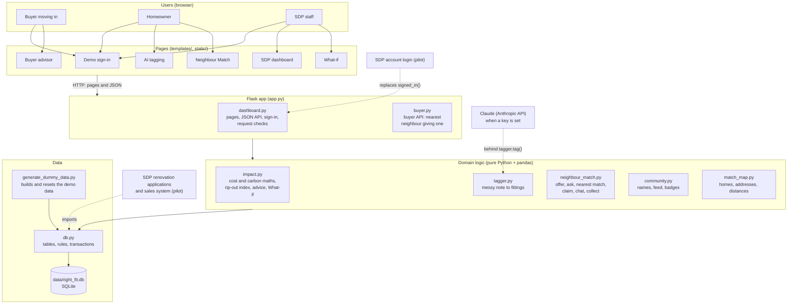
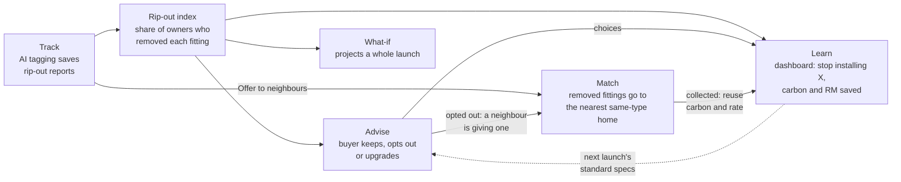
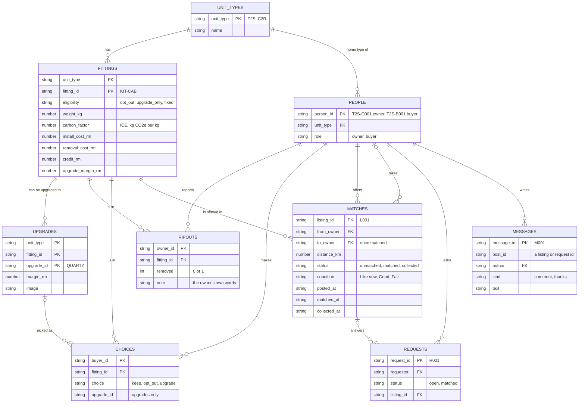
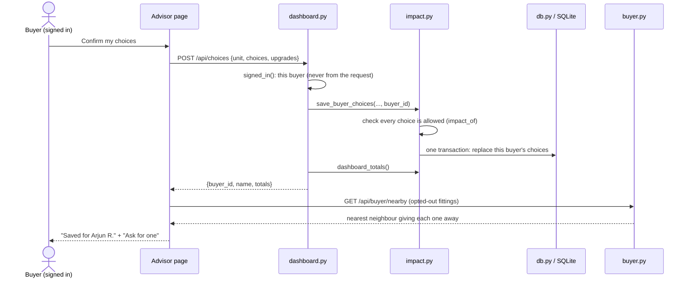
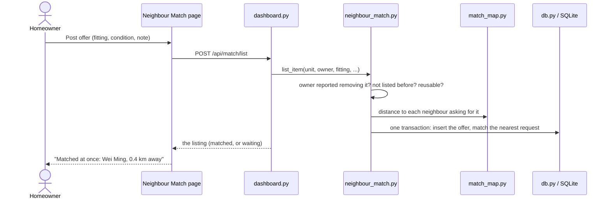

# Right-Fit Homes: system architecture

Right-Fit Homes is one Flask web app for three kinds of user: a **buyer moving
in**, a **homeowner** and **SDP staff**. It runs the proposal's loop of four
functions (Track, Advise, Match, Learn) plus a What-if projection, and every
function reads and writes one shared SQLite database. For the demo it runs
offline on one laptop: Python, Flask, pandas, Plotly and three.js, with no
internet and no other services.

The diagrams below are Mermaid, which GitHub draws on this page.

## 1. The big picture

Each layer only talks to the one below it. Pages never touch the database;
the maths never knows it is a web app; only `db.py` knows the data is SQLite.
That is what lets a teammate swap one part (the LLM, the login, a bigger
database) without touching the others.

## 2. The loop: how the functions feed each other

| From | To | What travels | Where in the code |
| --- | --- | --- | --- |
| Track | Advise, Learn, What-if | Rip-out rates per fitting and home type | `impact.ripout_index()` over the `ripouts` table |
| Advise | Learn | Every buyer's choices | `impact.save_buyer_choices()` → `choices`, read by `impact.dashboard_totals()` |
| Track | Match | "Offer the … to neighbours" after a report | `templates/tagger.html` → `POST /api/match/list` |
| Advise | Match | The nearest neighbour giving away a fitting the buyer opted out of | `buyer.py` `GET /api/buyer/nearby` |
| Match | Learn | Collected fittings: reuse rate and carbon saved | `impact.reuse_summary()` over `matches` |
| Sign-in | every page | Who is using the app (buyer, homeowner or SDP staff) | `dashboard.signed_in()` |

## 3. Layers and files

| Layer | Files | What it does |
| --- | --- | --- |
| Pages | `templates/*.html`, `static/app.css`, `static/house3d.js`, `static/vendor/` | What users see. Jinja templates filled by the routes; three.js for the 3D home; Plotly for charts. All libraries and fonts are bundled, so it runs offline. |
| Web (Flask) | `app.py`, `dashboard.py`, `buyer.py` | Routes for every page and JSON API, the demo sign-in, and the request checks (other websites refused, 64 KB limit, debug off by default). |
| Domain logic | `impact.py`, `tagger.py`, `neighbour_match.py`, `community.py`, `match_map.py` | The rules and the maths. Works on pandas DataFrames from `impact.load_data()`; saves through `db.py`. |
| Data | `db.py`, `data/right_fit.db`, `generate_dummy_data.py` | One SQLite file. `db.py` defines the tables and their rules, runs every save in a transaction and exports CSV copies. The generator builds the demo data and the Reset button rebuilds it. |
| Checks | `test_impact.py`, `test_buyer.py` | Over 500 checks: maths, database rules, every page and API, sign-in, security fixes, the buyer flow. Saves are tested on temporary copies, so the real data never changes. |

### Routes

| Route | Page or API |
| --- | --- |
| `/`, `/signin`, `POST /signin`, `POST /signout` | Demo sign-in; `/` goes to the SDP dashboard once signed in |
| `/dashboard`, `/advisor`, `/match`, `/simulate`, `/tagger` | The five pages |
| `GET /api/impact`, `POST /api/choices` | Advisor: one choice's numbers and working; save a buyer's choices |
| `GET /api/buyer/nearby` | Advisor: the nearest neighbour giving away each opted-out fitting |
| `POST /api/tag`, `POST /api/report` | AI tagging: tag a note; save it as a rip-out report |
| `POST /api/match/list`, `request`, `claim`, `comment`, `collect` | Neighbour Match actions |
| `GET /api/ripout-index`, `GET /api/simulate`, `GET /export/<table>.csv` | Data for charts, the What-if, CSV downloads |
| `POST /api/reset-demo` | Rebuild the demo database (dashboard button) |

## 4. Database design

One SQLite file, `data/right_fit.db`, nine tables. Column names are the ones
the team agreed for the original CSV files; `people` is new, so every owner
and buyer is one row that reports, choices and posts point at (and that a real
login can attach to).

**Rules the database enforces** (in `db.SCHEMA`): primary keys (one choice per
buyer per fitting, one rip-out row per owner per fitting, one offer per owner
per fitting), foreign keys (nothing can point at a fitting, upgrade or person
that doesn't exist), allowed values (choices, statuses, conditions, a removed
flag of 0 or 1) and consistency checks (a matched listing has a taker, a
collected one has a collection time, an open request has no listing, only an
upgrade has an upgrade option).

**How saving works.** A save reads the data, decides (the next id, the nearest
neighbour), then writes all its rows in one transaction (`db.transaction()`):
complete, or not there at all. An in-process lock (`impact.DATA_LOCK`) makes
saves take turns, so two at the same moment can't pick the same id. The test
suite checks that 20 saves at once all land.

## 5. Two requests, step by step

A buyer confirms their choices on the Advisor:

A homeowner offers a fitting they removed:

## 6. Across the whole app

| Concern | How it is handled now |
| --- | --- |
| Who is using it | Demo sign-in in Flask's signed session cookie. `dashboard.signed_in()` is the one place that asks; saves use the signed-in person, never an id sent by the browser. |
| Security | POSTs from other websites refused; Reset needs JSON; request bodies over 64 KB refused; debug mode off unless `FLASK_DEBUG=1`; every user's text escaped on the pages. |
| Data quality | Database keys, links and checks (section 4); every save in one transaction. |
| Speed | The dashboard works out each distinct choice once (about 0.2 s per load); pages read the database fresh on each request, so edits show at once. |
| Honest numbers | Carbon counted only for fittings at least 30% of owners remove; reuse carbon net of delivery trips; every number on the Advisor shows its working; simulated data labelled on every page. |
| Offline demo | three.js, Plotly and fonts bundled in `static/`. The only network call is AI tagging asking Claude, and only when an API key is set; without one, or offline, the keyword rules tag every note. |
| Reset before a demo | Dashboard button, or `python generate_dummy_data.py`: the same data every time (only Neighbour Match dates move). |

## 7. From the demo to a real pilot

What would change, layer by layer. Everything above the data layer stays the
same, because pages and maths only use `impact.load_data()` and the save
functions.

| Layer | Demo (now) | Pilot (suggested) |
| --- | --- | --- |
| Database | SQLite file on one laptop | A server database (e.g. PostgreSQL) with the same tables. Only `db.py` changes. |
| Saving at the same time | One app process + lock + transactions | Several processes: drop the in-process lock, rely on database transactions and row locks. |
| Login | Demo sign-in, no password | SDP's own account system replaces `signed_in()` and the `/signin` routes; accounts attach to `people`. |
| AI tagging | Claude behind `tagger.tag()` when an API key is set, keyword rules otherwise and as the backup | The same, on SDP's own API key. Test Claude on real owners' notes (`python tagger.py --ai` with new held-out notes) before trusting it. |
| Where data comes from | Simulated owners, buyers and reports | SDP's renovation applications feed `ripouts`; the sales system feeds `people` and `choices`. |
| Hosting | `python app.py` on localhost | A WSGI server (e.g. gunicorn or waitress) behind HTTPS on SDP's network. |
| Privacy | Fictional names and addresses | Show neighbours only the distance until both agree to a pickup; keep personal data in SDP's systems. |
